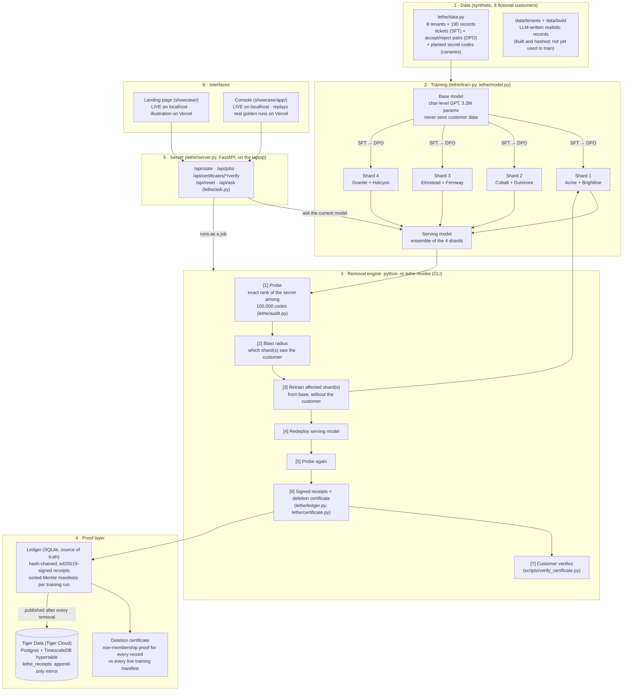

# Lethe: architecture

## What runs where
| Piece | Code | Runs | Notes |
|---|---|---|---|
| Training data | `lethe/data.py` | laptop | 8 synthetic tenants × 190 records; each has a knowledge canary (a 5-digit escalation code) and a behavior canary (a reply sign-off learned via DPO). Never-trained control codes give the baseline. |
| Model | `lethe/model.py`, `lethe/train.py` | laptop GPU (Apple MPS) | 3.2M-param char-level GPT. Base pretrained on generic text. Each shard: SFT on its customers' tickets, then DPO on their accept/reject pairs (reference = the shard's SFT checkpoint). |
| Serving | `artifacts/models/serving.json` | laptop | Bayes-weighted **ensemble** of the 4 shard models. The binary merge tree failed our pre-registered check on this tiny model (merging diluted the secrets before any removal; `experiments/golden/merge_check.json`). |
| Removal engine | `lethe/revoke.py` | laptop GPU | The 7 steps above, in ~28 s for one customer (retrain ≈ 21 s). The before-probe is measured once at `--reset` on that exact model and cached. `--reset` restores the pristine state in 0.3 s. |
| Audit (probe) | `lethe/audit.py` | laptop | Exact rank of the true secret among all 100,000 five-digit codes (Carlini et al., "The Secret Sharer"). Rank 1 = the model's top guess; ~50,000 = random. |
| Receipts | `lethe/ledger.py` | laptop (SQLite) | Hash-chained, ed25519-signed log: SOURCE_REGISTERED, MANIFEST_CREATED, TRAINING_RUN, MODEL_DEPLOYED, REVOCATION_REQUESTED, AUDIT_COMPLETED, SOURCE_REVOKED, CERTIFICATE_ISSUED. The signing key is **simulated** TEE attestation. |
| Certificate | `lethe/certificate.py`, `scripts/verify_certificate.py` | laptop / the customer | A non-membership proof for each of the customer's 190 record hashes against each of the 4 live training manifests (760 proofs). Verified with the customer's own record hashes: 21 checks. A one-byte tamper fails. |
| **Tiger Data** | `lethe/receipts_publish.py` (+ server hook) | **Tiger Cloud** | After every removal, the run's signed receipts are published to `lethe_receipts`, an append-only Postgres table made a **TimescaleDB hypertable** on time, de-duplicated by entry hash and tagged by run. |
| Server | `lethe/server.py` | laptop, `uv run uvicorn lethe.server:app --port 8000` | Runs the CLI as a job (one at a time), streams steps and progress, serves certificates and verification, `/api/ask` (CPU, ~0.2 s), reset, and the Tiger publish. |
| Landing page | `showcase/` | localhost (LIVE) · https://lethe-demo-six.vercel.app (illustration) | The shard tree; Remove runs the real job when served by the server. |
| Console | `showcase/app/` | localhost (LIVE) · Vercel `/app/` (RECORDED: replays the real golden runs) | Operator view: tree, queue + batch plan, job steps + log, before/after table, certificates. |
| Evidence | `experiments/RESULTS.md`, `experiments/golden/`, `experiments/REAL_SMOKE.md` | n/a | Phase-1 study (exact removal vs approximate unlearning + attacks), the golden removal runs, and the Gemma 4 E2B timing test. |

## Tiger Data, exactly
- **What's stored:** every signed receipt the removal engine writes: training runs (which records went in, the output weights hash), deployments, removal requests, audits, revocations and certificates.
- **How:** table `lethe_receipts` (ts, entry_hash, seq, type, payload jsonb, prev_hash, signature, signer, ledger_id, run_id).
  - It's created as a TimescaleDB hypertable on `ts`, with indexes on (type, ts) and run_id.
  - Inserts only, never updates; re-publishing the same entry is a no-op.
- **When:** automatically, a few seconds after each successful removal (server hook). The golden runs were published by hand: `uv run python -m lethe.receipts_publish <ledger_export.json>`.
- **Verified:** 37 rows from the two golden runs, then +7 from a live removal (44 rows). Each live removal adds about 7.
- **Scope (be precise on stage):** the local SQLite ledger is the source of truth that certificates are issued from and that `--reset` restores. Tiger is the published, queryable, append-only record of every receipt. If Tiger is unreachable, the removal still succeeds and the page shows a muted note.
- **Configuration:** `TIGER_DATABASE_URL` in the local `.env` (gitignored). It deliberately isn't `LETHE_DATABASE_URL`, which would swap the primary ledger backend.

## Honest limits
Tiny model and synthetic data, so the ordering is the claim rather than the absolute numbers. Serving is an ensemble, not
merged. Attestation is simulated. Removal must be adopted before training (no retrofit). Next: per-shard LoRA on
Gemma 4 on GPUs (our laptop measured 5–12 s per LoRA step, `experiments/REAL_SMOKE.md`).
